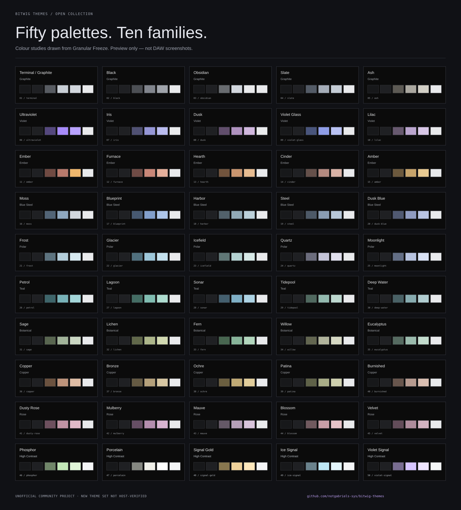

# Bitwig Themes · Gabriel

**50 dark colour themes in 10 families, built from the graphite, silver and restrained signal colours of Granular Freeze.** Free to use, adapt and share under the MIT licence.

[Browse the gallery](https://notgabriels-sys.github.io/bitwig-themes/) · [Installation](docs/INSTALL.md) · [All palettes](docs/PALETTES.md) · [Latest release](https://github.com/notgabriels-sys/bitwig-themes/releases)



## Start here

Choose a theme in the [gallery](https://notgabriels-sys.github.io/bitwig-themes/), select the `default.bte` exported by **your installed version** of [Bitwig Theme Editor](https://github.com/Berikai/bitwig-theme-editor), and download the complete `.bte`. The file is processed locally in your browser and is not uploaded. No Node.js installation is needed for this route.

For terminal use, the optional CLI requires Node.js 22 or later and has no npm dependencies:

```sh
git clone https://github.com/notgabriels-sys/bitwig-themes.git
cd bitwig-themes
node scripts/export-bitwig.mjs --list
node scripts/export-bitwig.mjs --theme terminal --base /path/to/default.bte --out ./exports/terminal.bte
```

Replace `/path/to/default.bte` with the file created for your Bitwig version. Import the generated file with Theme Editor. Read the [installation and recovery guide](docs/INSTALL.md) before applying it.

**Compatibility:** this collection targets the unofficial Bitwig Theme Editor workflow. It is not an official Bitwig theme pack or a native Preferences import. The exporter is structurally checked against locally generated Bitwig 6.1 and 6.1.1 defaults; the 50 resulting themes have **not been visually verified in Bitwig**. Gallery images are accurate palette studies, not DAW or plug-in screenshots. See [validation scope](docs/VALIDATION.md).

## The collection

Every theme uses dark neutral surfaces, readable silver text and a limited accent. Record, warning and success tokens remain separate from the theme accent. Theme groups help you find a mood without scrolling through fifty unrelated names.

The [palette directory](docs/PALETTES.md) lists all 10 groups and their five themes. **Terminal / Graphite** is the default; **Ultraviolet** carries the violet signal detail of Granular Freeze.

Six palettes retain the exact colour tokens in the current Granular Freeze appearance catalogue: Terminal / Graphite, Black, Obsidian, Ember, Ultraviolet and Moss. Terminal and Graphite shared identical colours, so they are one entry here, with `graphite` accepted as an alias. The other 44 themes are new variations for this collection. This repository does not add those variations to the plug-in. [Provenance and scope](docs/PROVENANCE.md).

## What is included

- **50 individual JSON palettes** grouped under `themes/`, plus a combined `catalog.json`.
- **Interactive gallery** with search, family filters, colour values and local `.bte` generation from your own default file.
- **SVG palette previews** generated directly from the published colours.
- **A local `.bte` exporter** that keeps your default file's full key structure, transparency, gradient setting and unmapped colours.
- **Validation and regression tests**, contribution guidance and issue templates.

Export all themes for your installed version:

```sh
node scripts/export-bitwig.mjs --all --base /path/to/default.bte --out ./exports
```

The CLI creates new files and refuses to overwrite an existing output. The browser offers the generated file as a download. Neither route patches Bitwig or replaces the active theme. No Bitwig JAR, factory default theme, audio, plug-in binary or external asset is included.

## Develop and contribute

```sh
npm run build
npm run check
npm test
python3 -m http.server 8080
```

Open `http://localhost:8080` to browse locally. No dependency installation is needed. See [CONTRIBUTING.md](CONTRIBUTING.md) for the colour contract and how to submit an actual Bitwig screenshot or compatibility report. The gallery runs entirely in the browser without analytics or external fonts.

Useful feedback includes the exact Bitwig version, Theme Editor version, operating system, theme name and the control or text that needs attention. Small, specific reports make this collection better.

## About

Made by [Gabriel García Alonso](https://github.com/notgabriels-sys), a sound engineer, producer and live performer based in Berlin, working as Hologram People and with Lack of Fate / Fate Through. These colours grew out of building a comfortable visual language for music tools.

If this collection helps your sessions, a star or a link back helps other musicians find it. Forks and thoughtful contributions are welcome.

Independent community project. Bitwig is a trademark of Bitwig GmbH; no affiliation or endorsement is implied. The MIT licence covers the original palettes, exporter, documentation and gallery here. Bitwig and the separately obtained Theme Editor retain their own licences.
