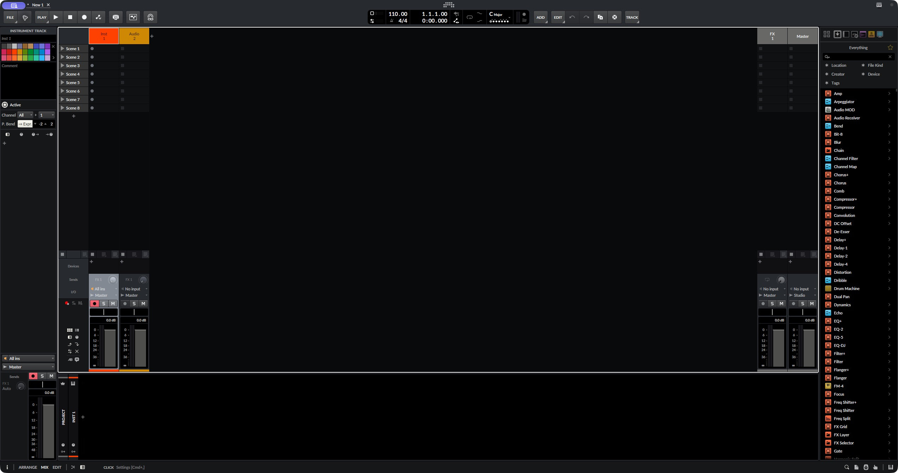
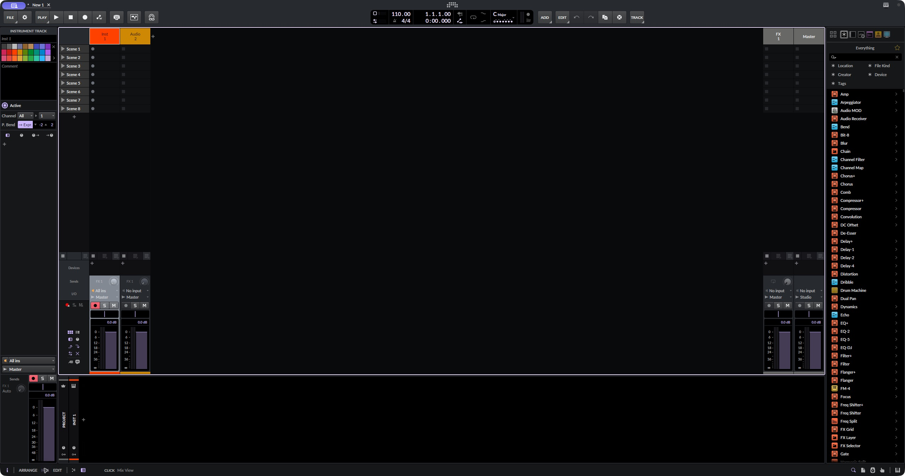

# Validation scope

Release 0.1.1 adds browser-local export to the initial public preview. Palette data can be inspected and reused now. The original release evidence below is supplemented by the version-specific host smoke checks recorded on 14 October 2026.

## Browser export update · 0.1.1

All **34 tests passed** on macOS with Node.js 26.0.0: the 20 original regressions plus 14 browser-export tests. The added cases cover a 2 MiB limit before reading, malformed/sparse inputs, complete shared-renderer output, theme changes during reads, overlapping file reads, invalid replacements, clear/cancel behaviour, Blob cleanup and safe text handling. The export helper makes no network calls and stores file contents only in browser memory.

Manual browser checks used an explicitly synthetic 220-key base, not a Bitwig factory default. Selecting Ultraviolet enabled `ultraviolet.bte`; selecting Ember regenerated `ember.bte`. The actual downloaded Ember file matched the shared renderer byte for byte. A sparse input displayed its validation error and removed the previous download; Clear file reset the state. The 390×844 viewport had no horizontal overflow. This verifies browser export behaviour, not visual Bitwig compatibility.

Both browser and CLI use the unchanged shared BTE renderer; the version-specific structural evidence below continues to describe that renderer. Those browser checks do not establish host acceptance; the later native host checks are described separately below.

## Automated checks

The repository includes reproducible validation for:

- Exactly 50 unique complete palettes, 10 groups of 5, stable IDs and unambiguous aliases.
- Seventeen valid RGB tokens per theme, matching individual JSON files and generated palette SVGs.
- At least 4.5:1 opaque text contrast on raised panels, 4.5:1 muted text on panels, and 3:1 accent/focus on panels.
- Dark, neutral surface colours and provenance for the six inherited palettes.
- Exporter parsing, malformed/sparse input rejection, duplicate keys, exact key matching, preservation of unmapped values/alpha/gradient and prevention of output overwrites.
- Reproducible generated assets and a release archive containing only public project files.

These checks are run by the GitHub workflow and can be repeated using `npm run build`, `npm run check` and `npm test`. The local validation record below states the actual results for this release.

## Local release record · 10 September 2026

The final local checks ran on macOS with Node.js 26.0.0. CI uses Node.js 22 on Ubuntu.

| Check | Result |
| --- | --- |
| `npm run build` | Passed; regenerated catalogue, 50 JSON files and 51 SVGs |
| `npm run check` | Passed; 50 distinct palettes, 10 groups, token and preview checks |
| `npm test` | Passed; 20 tests, no failures or skipped tests |
| Original-source preservation | Six fixed palette signatures pass; all 17 tokens retained |
| Local full `.bte` exports | 50 themes each from Bitwig 6.1 and 6.1.1 defaults; exact 273 colour keys plus Gradient retained |
| Semantic mapping | 143 actual colour keys mapped; unmapped values and every alpha byte retained |
| Grey ramp | Increasing Grey 0–6 luminance verified for every theme |
| Browser | Family filter, theme selection, empty search/reset, direct JSON links and copy command verified in Codex's browser |
| Responsive layout | Phone viewport tested at 390×844; no horizontal overflow |
| Browser console | No warnings or errors observed during gallery checks |
| Served files | HTML, catalogue, CSS, JavaScript, one JSON download and overview SVG byte-match local files |
| Release archive | Integrity checked; explicit public-file list excludes local defaults and generated `.bte` exports |

Minimum measured opaque token contrast across the 50 palettes: primary text on raised panel **13.53:1**, muted text on panel **7.10:1**, accent on panel **4.80:1**, and focus on panel **7.10:1**.

The base files and 100 generated `.bte` exports stay local and are excluded from the repository and release. Windows and Linux application installation and visual behaviour have not been checked.

## Native host smoke checks · 14 October 2026

Bitwig Studio **6.1.4 on macOS**, patched with the separately obtained community Theme Editor **2.3.2**. The full original 0.1.1 catalogue was exported using that installed version's native default: 50 exports, each retaining 273 colour keys, alpha and Gradient, with 143 semantic keys mapped.

All 50 themes were loaded into the real host and their settings-view captures reviewed for colour rendering, selected/unselected controls and visible labels. Arrangement smoke checks and representative Porcelain and Violet Signal mixer views were also reviewed. No obvious unreadable controls were observed in these reviewed views. This was a blank New 1 project with transport stopped, not audio processing or exhaustive device/project testing.

The current personal theme was backed up before testing and restored byte for byte afterwards; the restored graphite/silver/violet interface was observed. Some initial captures were stale because of native UI focus/refresh timing; they were excluded and replaced by individually confirmed captures. One normal quit/relaunch was used; no force quit or discard of music work occurred.

These are bounded visual smoke checks, not WCAG certification, user acceptance, endorsement, or compatibility evidence for other versions/platforms. Windows and Linux installation remains untested. The full per-theme captures and original defaults/exports remain local; only the two representative captures below are published. The exporter itself performs no restart, live-theme replacement or JAR patch.

The gallery shows exact published palette colours. It contains no captured Bitwig interface. A passing token contrast check does not establish WCAG conformance for Bitwig: text roles, stock colours, transparency and layered states may produce different results in the actual application.

Compatibility reports should include a real capture, theme ID, exact Bitwig version, exact Theme Editor version and OS. Reports can be submitted using the compatibility issue template.
